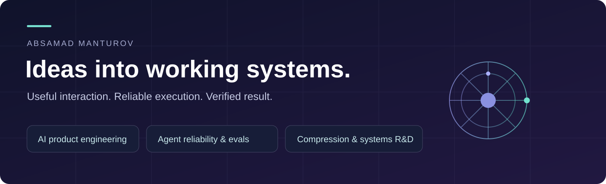

# Engineering portfolio

I build AI products and the infrastructure that makes their actions dependable. My work connects conversational interfaces, business workflows, durable execution and performance research.

**Start with a working product, then inspect the engineering proof.**

[GitHub profile](https://github.com/Absamad-dew) · [Email](mailto:absamad.manturov@gmail.com) · [Telegram](https://t.me/Absamad_m)

## Products

| Project | Problem solved | Explore |
|---|---|---|
| **Aster** | Let a business owner operate sales and a detailed CRM through conversation, while customers progress from a question to an order and invoice. | [Product walkthrough and verification](projects/aster.md) |
| **CoreBroker** | Keep concurrent agent builds, tests and experiments from competing blindly for the same machine. | [Resource coordination and an actual run receipt](projects/corebroker.md) |
| **Tervallis** | Keep projects, decisions, experiments and agent results in one persistent working context. | [Research operations and MCP workflows](projects/tervallis.md) |

These three products are presented through descriptions and demonstrations. Their source code is private.

## Public engineering you can run

| Repository | The concrete engineering question |
|---|---|
| [agent-action-ledger](https://github.com/Absamad-dew/agent-action-ledger) | What happens if a process dies after the remote action succeeds but before its receipt is stored? |
| [ru-agent-eval-kit](https://github.com/Absamad-dew/ru-agent-eval-kit) | Did an agent actually change the expected state, or merely say it succeeded? |
| [ruagent-compat](https://github.com/Absamad-dew/ruagent-compat) | Can tool contracts survive malformed output, denied actions and concurrent duplicate calls? |
| [compression-observatory](https://github.com/Absamad-dew/compression-observatory) | Which lossless operating points remain competitive when bytes, time and exact reconstruction are measured together? |
| [dlss5-video-studio](https://github.com/Absamad-dew/dlss5-video-studio) | How do motion/depth inference, native D3D12 processing, video transport and encoding fit into a usable Windows application? |
| [price-intelligence-demo](https://github.com/Absamad-dew/price-intelligence-demo) | How do inconsistent supplier files become comparable prices without quietly mixing currencies or hiding uncertain rows? |

## Research

[Compression R&D overview](research/README.md) connects the public ChronoField results to the broader research direction. The research implementations and unpublished techniques are kept separate from the open-source tooling.

## How I work

[Agent-assisted engineering](docs/working-with-agents.md) explains how I divide work, review boundaries and test outcomes. [Evidence index](docs/evidence.md) separates runnable public checks, recorded product verification and research measurements.

Moscow · remote work and relocation · AI product engineering, agent reliability and systems/R&D roles.
