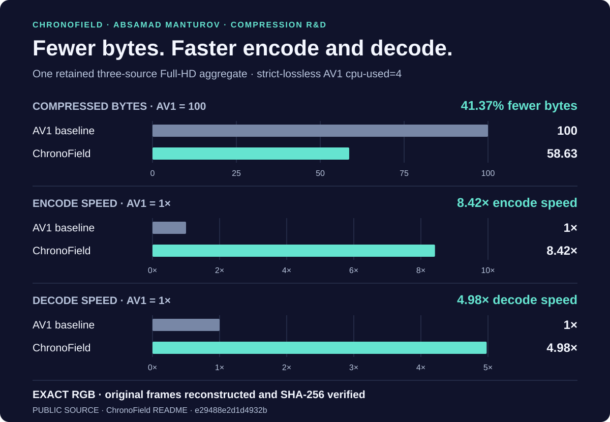
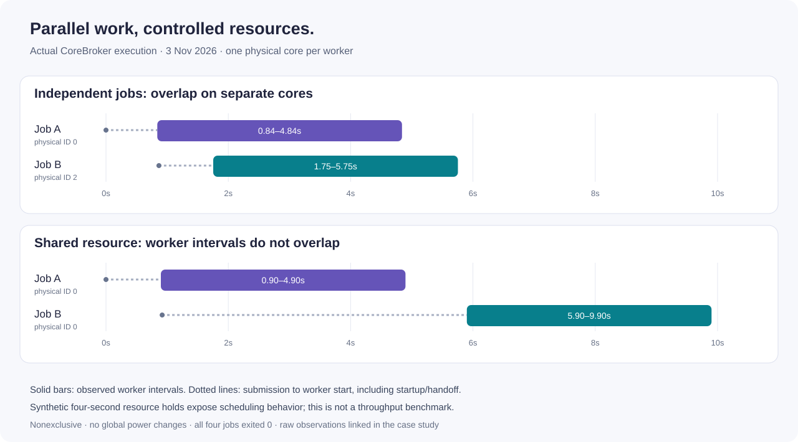

# Absamad Manturov — selected engineering work

I build autonomous business software and systems for running computational work efficiently. This portfolio brings together the products, original research and engineering decisions behind them.

[Aster](projects/aster.md) · [ChronoField](research/README.md) · [CoreBroker](projects/corebroker.md) · [Video Studio](https://github.com/Absamad-dew/dlss5-video-studio) · [Tervallis](projects/tervallis.md)

[GitHub profile](https://github.com/Absamad-dew) · [Русский](README.ru.md) · [Email](mailto:absamad.manturov@gmail.com) · [Telegram](https://t.me/Absamad_m)

## Aster · from a customer conversation to business operations

A sales agent connected to a full CRM. It explains services, collects the brief and records orders, invoices and bookings. The owner can use chat or voice while staff keep the detailed customer, company, finance, stock and team workspace. The initial prototype took two days; integration and reliability work continued afterward.

**The result shown:** two menu layouts at 3,500 RUB each, an accepted 7,000 RUB order and its invoice awaiting payment, visible beside the customer conversation.

[Walkthrough: customers, owner, team and autonomy](projects/aster.md) · [Verification snapshot](docs/aster-verification.md)

## ChronoField · original compression R&D

A native exact-video codec and related-rendition storage system. The published three-source Full-HD comparison records **41.37% fewer bytes, 8.42× encode speed and 4.98× decode speed** against the measured strict-lossless AV1 baseline, with exact RGB reconstruction.

A separate family-storage result reduces already-compressed related outputs from **45.14 MB to 7.38 MB**, including the catalog metadata, with all 20 outputs reconstructed exactly.

[Results and comparison conditions](research/README.md) · [Обзор на русском](research/README.ru.md) · [PTC, neural weights, KV cache and other research](research/other-work.md)

## CoreBroker · parallel work with explicit resources

A Windows coordinator for builds, tests and agent workloads. Physical-core leases, named resource locks and process history make parallelism manageable across projects.

In the recorded coordination demonstration, independent workers overlap for **3.087 seconds** on separate physical cores. With the same named lock, the second worker waits and their observed execution intervals do not overlap.

[Engineering case and raw observations](projects/corebroker.md)

## Video Studio · native GPU video pipeline

A Windows application with realtime, recording and stereo/VR workflows. Its public C++/D3D12 implementation connects persistent producers, bounded frame transport, GPU resource ownership, NVENC and the audio playback clock.

The retained native-stage A/B measurement improved **24.393 → 29.981 FPS (+22.9%)** under matched settings. The engineering tour traces the resource-lifetime, backpressure and encoder decisions to stable source lines.

[Public project](https://github.com/Absamad-dew/dlss5-video-studio) · [Engineering tour](https://github.com/Absamad-dew/dlss5-video-studio/blob/main/ENGINEERING_OVERVIEW.md) · [Обзор на русском](https://github.com/Absamad-dew/dlss5-video-studio/blob/main/ENGINEERING_OVERVIEW_RU.md)

## Tervallis · persistent context for research and agents

My working platform for projects, tasks, experiments, decisions and files. I organized work across **20 agents**, with MCP integrations returning a task's result to the project discussion that requested it. Versioned operations, idempotent creation and read-back checks keep handoffs connected to saved state.

[Case: discussion → claimed work → saved result](projects/tervallis.md)

## My role

I define product behavior, make system-level decisions, organize agent-assisted implementation and integrate the result. Earlier work included internal automation across three related businesses, around 15 people in total. [Working with agents](docs/working-with-agents.md) describes the delivery approach through concrete examples.

Aster, CoreBroker and Tervallis are shown through descriptions and demonstrations; their implementations remain private. Research source and protected techniques stay closed. The linked cases give the scope of each captured result. [Sources and media provenance](docs/evidence.md).

Additional public libraries and engineering experiments

- [Agent Action Ledger](https://github.com/Absamad-dew/agent-action-ledger): durable tool actions and reconciliation after uncertain outcomes.
- [RU Agent Eval Kit](https://github.com/Absamad-dew/ru-agent-eval-kit): observed tool outcomes, fault injection and a recorded local model run.
- [ruagent-compat](https://github.com/Absamad-dew/ruagent-compat): executable tool contracts and concurrency regressions.
- [Compression Observatory](https://github.com/Absamad-dew/compression-observatory): exact round trips, weighted aggregation and Pareto reports for standard codecs.
- [Price Intelligence](https://github.com/Absamad-dew/price-intelligence-demo): supplier normalization, currency-aware comparisons and a review queue.

