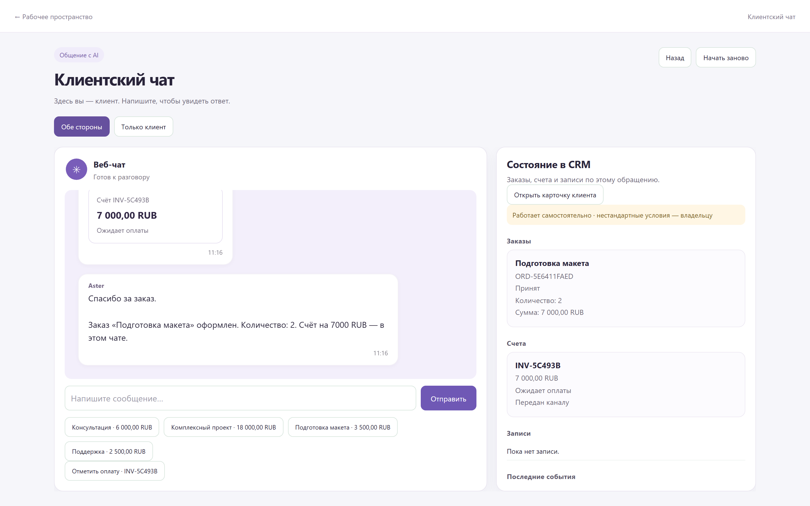

# Абсамад Мантуров · Инженерное портфолио

Проектирую ИИ-агентов, которые оформляют заказы, выставляют счета и работают с расписанием. Определяю архитектуру и правила действий, веду реализацию с агентами и проверяю, что система выполнила операцию.

[English](README.md) · [Профиль GitHub](https://github.com/Absamad-dew) · [Почта](mailto:absamad.manturov@gmail.com)

## Aster · Голосовая CRM и агент продаж

Aster ведёт обращение от уточнения запроса до заказа и счёта. Я определил доступные агенту действия, правила передачи сотруднику и критерии приёмки. На экране видны переписка, сохранённый заказ на два макета и счёт на **7 000 ₽** в статусе ожидания оплаты. [Кейс Aster](projects/aster.ru.md) · [Записи проверок](docs/aster-verification.md)

В локальном прогоне отмена заказа аннулировала неоплаченный счёт, повторное событие оплаты оставляло оплаченный счёт без изменений, а нестандартные скидки и возвраты переходили сотруднику. В отдельном тесте воспроизвёл сбой ответа модели и проверил, что после исправления ассистент открыл нужный экран продаж. [Решения и проверки](projects/aster.ru.md#действия-агента-и-проверки)

## Автоматизация бизнеса · 2018–2026

Разработал и внедрил инструменты для **трёх связанных компаний**. Связал входящие обращения, условия клиента и расчёт цены с CRM, согласовал правила с руководителем и менеджером и помог сотрудникам перейти на новые инструменты. [Рабочие кейсы](projects/business-automation.md)

| Операция | Примерное время по рабочим оценкам |
| --- | --- |
| Первый ответ клиенту | Раньше ожидание до часа, после внедрения около **2 минут** |
| Проверка макета и PDF для клиента | Около **30 секунд** при оценке ручной работы в 20 минут |
| Подготовка файла для ArtCAM | С двух часов до **40 минут** |

## Проекты

| Проект | Что посмотреть |
| --- | --- |
| **Tervallis** | Организовал работу около 20 агентов и проверил полный цикл MCP от поручения в обсуждении до сохранённого результата. [Кейс платформы](projects/tervallis.md) |
| **PTC и ChronoField** | Сжатие изображений, веба и JSON, память приложений и моделей, геометрия и видео. [Результаты сравнений](research/recent-results.ru.md) |
| **Video Studio** | Запись видео на C++ через D3D12 и NVENC. Скорость нативного этапа в сопоставимом замере выросла с 24,39 до 29,98 FPS. [Исходники и замеры](https://github.com/Absamad-dew/dlss5-video-studio/blob/main/ENGINEERING_OVERVIEW_RU.md) |
| **CoreBroker** | Координация нагрузок на Windows. В записанном прогоне независимые процессы выполняются параллельно, а задачи с общим ресурсом по очереди. [Кейс системы](projects/corebroker.md) |

## Результаты

- **PTC Simbol.** На 30 фото CLIC 2025 превзошёл по среднему RGB PSNR десять базовых пресетов SPCP при лимите 1,6 бит/пиксель. [Внешний и внутренние наборы](research/recent-results.ru.md#ptc-simbol)
- **PTC Web.** Архивы **на 21,85% меньше Brotli 11** на 125 ресурсах с 50 сайтов. Восстановление побайтное. [Наборы и сравнения](research/recent-results.ru.md#ptc-web)
- **PTKV.** Выгрузка сессии на 260 000 токенов освободила **1 340 МиБ видеопамяти**. Все 2 000 проверенных токенов продолжения совпали. [Замеры сессии](research/recent-results.ru.md#ptkv)
- **ChronoField.** На трёх источниках Full HD **на 41,37% меньше байт** и кодирование **в 8,42 раза быстрее** измеренного AV1 без потерь, с точным восстановлением RGB. [Замеры видео](research/recent-results.ru.md#chronofield)

[Все девять исследовательских кейсов](research/recent-results.ru.md) · [Индекс исследований](research/README.ru.md)

## Подход к разработке

До распределения работ определяю, что проверять при приёмке. В Aster это сохранённый заказ, счёт и состояние оплаты. В Tervallis это результат, который вернулся в исходный проект. В кодеках это полный размер файла и качество восстановленных данных. [Работа с агентами](docs/working-with-agents.md) · [Технические решения](docs/decision-stories.md) · [Подтверждающие материалы](docs/evidence.md)

## Открытый код

- **Memanto / LangGraph.** Исправление повторной записи и регрессионная проверка приняты в основной код проекта. [Подтверждение](docs/open-source-contributions.md)
- **Агентные системы.** [Контракты инструментов и проверки конкурентных вызовов](https://github.com/Absamad-dew/ruagent-compat) · [Журнал действий](https://github.com/Absamad-dew/agent-action-ledger) · [Оценка агентных действий](https://github.com/Absamad-dew/ru-agent-eval-kit)
- **Другие реализации.** [Video Studio](https://github.com/Absamad-dew/dlss5-video-studio) · [Релиз 22.3.0](https://github.com/Absamad-dew/dlss5-video-studio/releases/tag/v22.3.0) · [Compression Observatory](https://github.com/Absamad-dew/compression-observatory) · [Сравнение цен поставщиков](https://github.com/Absamad-dew/price-intelligence-demo)
