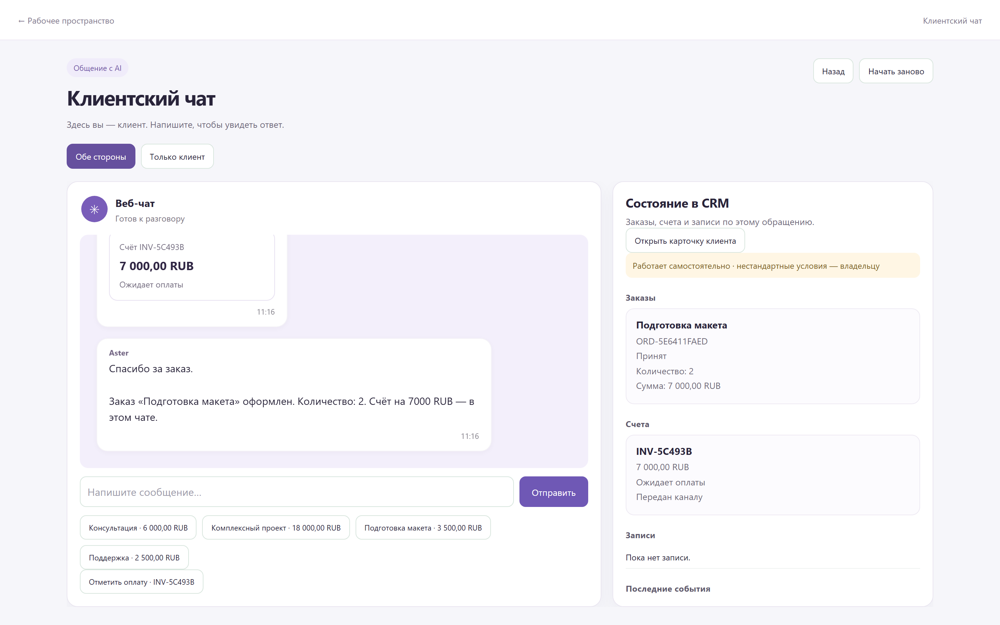
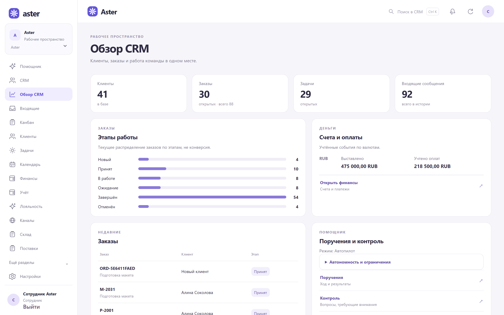
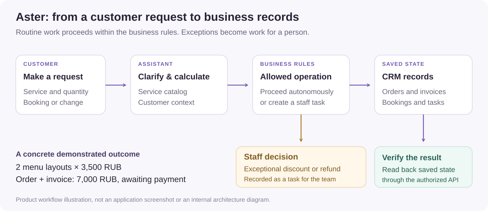

# Aster: sales conversations connected to business operations

Aster lets a service business answer customer questions, collect a brief, create orders and invoices, and manage bookings in the same system its staff use to run the business. The owner can work through an assistant or open the full CRM; routine operations can proceed autonomously, with exceptional commercial decisions assigned to people.

**My role:** product definition, system design, integration and acceptance of agent-assisted implementation.

## 1. A customer request becomes an order and invoice

A customer asks about a café menu layout. Aster explains the service and its **3,500 RUB unit price**, clarifies the request and records an order for **two layouts, totaling 7,000 RUB**. The customer receives the matching invoice in the conversation.

The demonstration shows both sides together: the customer response on the left and the resulting CRM order and invoice on the right. The invoice is **awaiting payment**; creating or presenting it does not mark it paid.

**The decision to inspect:** the conversation can initiate a sale, but the accepted result is the matching business record. Compare the quantity, total and payment status across the two sides of the capture.

*Actual application capture with synthetic business records, presentation build 0.54. The service explanation shown in the [earlier conversation capture](../media/aster-chat.png) is a real model response.*

## 2. The owner and team work from the same records

The assistant sits alongside a complete operations workspace: customer and company profiles, conversation history, kanban, schedules, team tasks, orders, invoices, recorded payments, stock and materials. Chat and voice are entry points to that workspace; conversational requests can surface tables and charts, while staff retain the detailed CRM controls.

The captured dashboard connects incoming work, order stages, outstanding invoices and team attention. An owner can follow a commercial result into the underlying customer or order instead of accepting a summary without context.

## 3. Routine autonomy, explicit commercial decisions

Autonomy is defined by the business operation and its allowed outcome. A standard request can produce an order or booking. An unusual discount or refund becomes a staff task. A payment state requires a payment event; a sentence from the assistant is insufficient.

The retained v0.55 scenario run exercised the lifecycle beyond an initial sale:

| Business situation | Observed result |
|---|---|
| Cancel an unpaid order | The associated invoice is voided. |
| Change or cancel a booking | Three new bookings were rescheduled and confirmed; two were cancelled. |
| Request an exceptional discount or refund | Four separate staff tasks were created. |
| Handle an already-paid invoice | The invoice was not paid again in the local payment checks. |

## 4. Engineering decisions and my approach

I use agents for implementation and investigation; I own the product behavior, system boundaries, integration and the decision to accept a result.

The central acceptance question is whether the business records match the conversation. In the v0.55 verification, all **40 existing presentation conversations** were completed and read back through the authorized API, with an actual model response in every conversation. Failed intermediate turns remained in the history after successful continuation. Delivery claims also remain tied to receipts: an earlier invoice handoff cannot justify claiming a new delivery.

The same work covered tenant and staff access boundaries, history preservation and the customer interface at desktop and mobile widths. [Verification scope and selected results](../docs/aster-verification.md) keep the build-specific evidence separate from the product walkthrough.

[Two concrete Aster decisions](../docs/decision-stories.md#1-aster-accept-the-business-record) explain the acceptance boundary and why failed turns and delivery receipts remain part of the result. [Working with agents](../docs/working-with-agents.md) connects that judgment to ownership, integration and the dated public artifacts.

**Demonstration scope:** synthetic business data in a running local application; external channels and bank events use local adapters. The v0.55 run used text, with no real customers, charges or physical microphone. Product source and runtime data remain private.

Кратко по-русски

Aster связывает клиентский диалог с операционной работой бизнеса: уточняет услугу и количество, создаёт заказ и счёт, ведёт записи и передаёт нестандартные скидки и возвраты сотрудникам. Владелец работает через ассистента или полноценную CRM с клиентами, перепиской, канбаном, расписанием, командными задачами, финансами и учётом. В продукте предусмотрены чат и голосовой интерфейс.

На реальном скриншоте приложения клиент заказывает два макета по 3 500 ₽: рядом с перепиской видны заказ и счёт на 7 000 ₽ со статусом ожидания оплаты. Это результат в бизнес-записях, а не только фраза ассистента.

Моя роль — постановка продукта, системные решения, интеграция агентской разработки и приёмка по наблюдаемому состоянию. В проверке v0.55 завершены и повторно сверены через API 40 презентационных бесед; в каждой есть настоящий ответ модели. Проверены также отмены, переносы, исключения и сохранение истории неудачных ходов.

В v0.55 я проверял сценарии целиком, от ответа клиенту до сохранённого заказа, счёта или задачи для сотрудника.

Демонстрационные данные синтетические; внешние каналы и банковские события локальные. Реальных клиентов, списаний и физического микрофона в этом прогоне не было. Исходники закрыты.

[Evidence and media provenance](../docs/evidence.md) · [Back to portfolio](../README.md)
