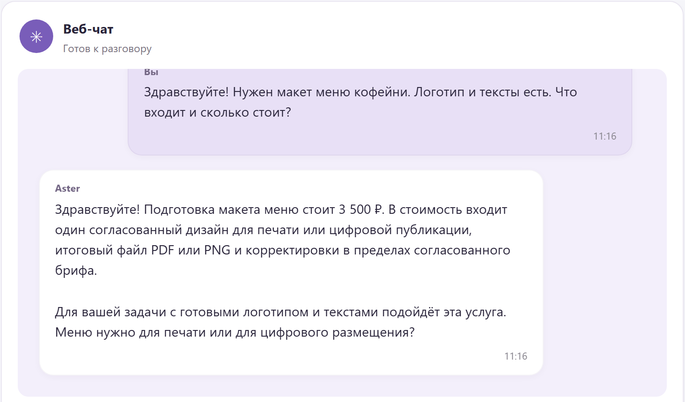

# Aster: conversational business operations

A business owner should be able to ask “What happened to sales this week?”, see the relevant chart, open a customer's conversation and assign the next action without navigating several disconnected tools.

Aster combines that conversational entry point with a detailed CRM. The initial prototype was built over two days, followed by successive integration, interface and reliability work.

## Two sides of the product

**For customers:** a sales conversation grounded in the service catalog and customer history. It collects the brief, calculates quantities and prices, creates an order and invoice, handles booking changes and routes exceptional discounts or refunds for review.

**For owners and staff:** a chat and voice assistant backed by customer/company profiles, conversation history, kanban, schedules, team tasks, orders, invoices, payments, stock and material accounting. Requests can reveal tables and charts directly in the conversation. Staff retain access to the full CRM.

## From conversation to a recorded order

In the captured service-catalog scenario, the assistant explains the offer, collects the request for two menu layouts, creates an order for **7,000 RUB** and presents the matching invoice. The customer view and CRM records are shown together, so the result is visible beyond the assistant's reply.

## Engineering focus

- Separate conversational intent from the authority to change business records.
- Verify state changes and their receipts; do not treat generated text as evidence of payment or delivery.
- Keep tenant and employee access boundaries in the execution path.
- Support normal autonomous workflows while escalating unusual commercial decisions.
- Preserve failures and conversation history when a later attempt succeeds.
- Keep external connectors replaceable without coupling the product interface to one channel.

## Recorded verification, version 0.55

The private build's retained verification snapshot records **40 completed customer conversations, 111 inbound text steps and actual model responses in every conversation**. It observed 9 new orders, 11 invoices (9 issued and 2 voided), 5 bookings and 4 human exception tasks. Final records were read back through the authorized API. Intermediate failed turns were retained.

The same snapshot records **1,208 passing Python tests, one skip and 127 passing Node test groups**, plus customer/report interface checks at 1,200 and 390 pixels. These are recorded checks of that build, not a claim of commercial scale or a language-quality score.

## Demonstration boundary

The screenshots show synthetic business records in a running application. Customer messages contain real model responses. External business channels and bank events in this presentation are local adapters; no real customer was contacted or charged. The full source, runtime databases and provider sessions are private.

[Evidence and media provenance](../docs/evidence.md) · [Back to portfolio](../README.md)
