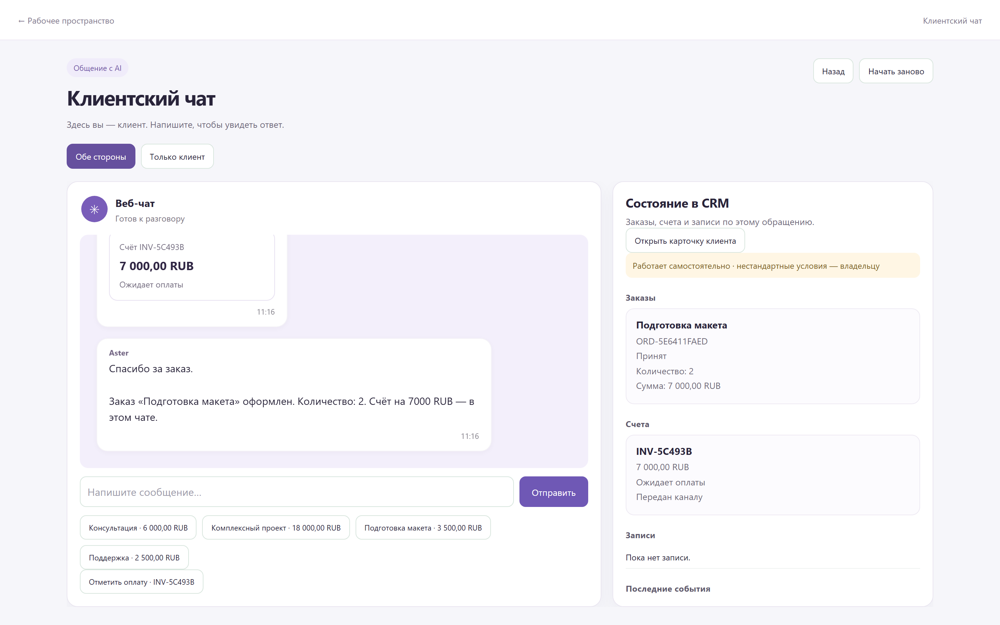
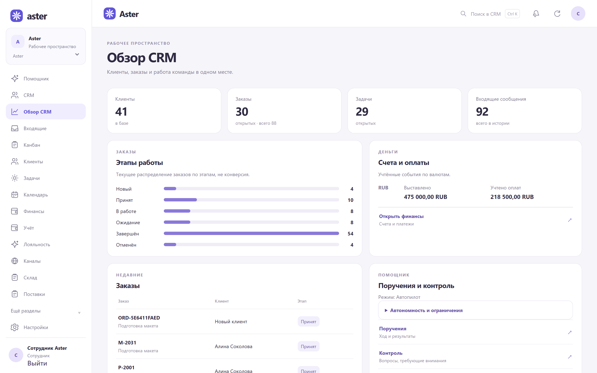

# Aster · Голосовая CRM и агент продаж

Aster ведёт обращение от вопроса клиента до заказа, счёта или записи. Владелец работает с теми же данными в CRM, через чат или голосом. Я определил поведение продукта, правила действий агента и условия приёмки, распределял реализацию между агентами и интегрировал результат.

[English](aster.md) · [Портфолио](../README.ru.md)

## Заказ из клиентского диалога

Клиент спрашивает о подготовке макета меню. Агент объясняет услугу и цену **3 500 ₽**, уточняет количество, сохраняет заказ на два макета и показывает счёт на **7 000 ₽**. В CRM видны те же количество и сумма, а состояние счёта показывает ожидание оплаты.

Снимок сделан в работающем локальном приложении версии 0.54 на синтетических данных. [Ответ модели в начале этого сценария](../media/aster-chat.png)

## Действия агента и проверки

| Ситуация | Что произошло в локальном прогоне |
| --- | --- |
| Клиент отменяет неоплаченный заказ | Связанный счёт аннулирован |
| Клиент переносит или отменяет запись | Три записи перенесены и подтверждены, две отменены |
| Клиент запрашивает нестандартную скидку или возврат | В четырёх случаях созданы отдельные задачи сотрудникам |
| Повторно приходит событие по оплаченному счёту | Состояние и результат оплаты сохранены |

Я задал правила для обычных операций и передачи исключений. Сверку после диалогов выполнял по заказам, счетам и записям через API. В проверке 0.55 сохранились промежуточные ошибки и результат повторного прохода. Для новой доставки счёта требуется новая квитанция. [Проверка версии 0.55](../docs/aster-verification.md#end-to-end-observations)

В отдельном сценарии сложный вопрос о продажах привёл к ответу модели с полями вне схемы. Сервер отклонил ответ. Я уточнил требования к формату и повторил сценарий со строгой проверкой. Корректный запрос открыл панель продаж. [Проверка ответа модели](../docs/aster-verification.md#model-response-validation)

## Работа владельца и команды

В голосовом разговоре владелец может открыть график продаж, расписание или карточку клиента и уточнить запрос. Сотрудники работают с перепиской, клиентами, заказами, канбаном, расписанием, счетами и складом в одном рабочем пространстве.

Проверки выполнены на синтетических бизнес-записях с локальными адаптерами каналов и платёжных событий. [Источники демонстрации и проверок](../docs/evidence.md#aster)
