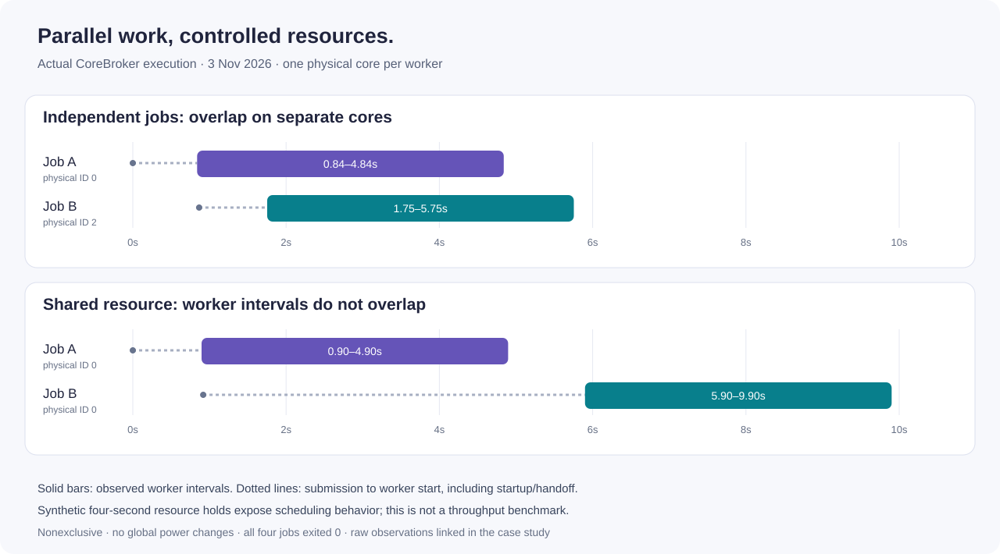

# CoreBroker

**Resource coordination for parallel agents, builds and experiments on Windows.**

When several agents start compilers, test suites or model experiments together, “more parallel work” can become contention for the same CPU cores, cache, GPU or disk. CoreBroker provides one place to submit that work, assign resources, wait for shared capacity and inspect the completed process.

I designed and developed the coordinator through agent-assisted implementation, and use it in my own engineering workflow. My responsibility covers the submission/queue model, physical-core allocation, resource locks, process lifecycle and the telemetry used to decide what to optimize next.

## Watch the coordination happen

This demonstration ran the installed CoreBroker against four owned synthetic workers. Each worker held its assigned resource for four seconds. The intervals above come from actual process markers, not an illustrated schedule.

| Scenario | Observed behavior |
|---|---|
| Two independent jobs | Separate physical core IDs **0 and 2**, with logical pairs **0–1 and 2–3**. Worker execution overlapped for **3.087 seconds**. |
| Two jobs with the same named lock | Job B was submitted while A was running. B began after A finished; observed worker overlap was **zero**. |
| Completion | All four jobs exited **0**. Each run retained its allocation and lease identifier. |

[Raw, curated observations](../media/corebroker-coordination.json) · [Capture conditions and verification](../docs/corebroker-demonstration.md)

## The engineering decisions

**Allocate physical cores together with their SMT siblings.** A logical-CPU count alone can hide two workers competing for the same physical resources. Every run reports the actual allocation.

**Treat shared resources explicitly.** A GPU or disk bottleneck needs a named lock in addition to CPU capacity. A waiting job should stay queued rather than quietly run outside the coordinator.

**Own the process lifecycle.** A submitted job is tracked through queueing, execution under a resource lease, and completion. Exit status, duration and history distinguish a completed result from a task that merely started.

**Measure before assigning more resources.** The CLI supports repeated benchmarks, telemetry comparisons and allocation recommendations. It exposes the conditions needed to interpret a result: cores, cache group, exclusivity and power settings.

## What it enables

The same coordinator is used to schedule this portfolio's tests and compression measurements. It supports the practical workflow I need for agent-assisted engineering: several independent projects can make progress while heavy stages declare the resources they compete for.

CoreBroker is a private implementation, shown here through its public case and real execution observations. It coordinates participating processes; ordinary unmanaged Windows applications remain outside its control.

Кратко по-русски

CoreBroker распределяет ресурсы между сборками, тестами и агентскими задачами на Windows. Я отвечаю за модель очереди, выделение физических ядер, блокировки общих ресурсов, жизненный цикл процессов и измерения. В демонстрации независимые задачи выполняются одновременно на разных ядрах; общий ресурс последовательно допускает к работе только одну задачу. На графике показан настоящий запуск, а не обещание универсального ускорения.

[Back to selected work](../README.md)
