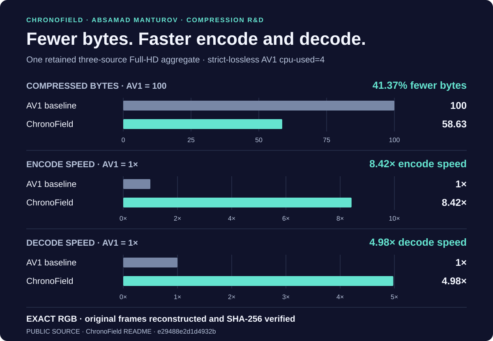
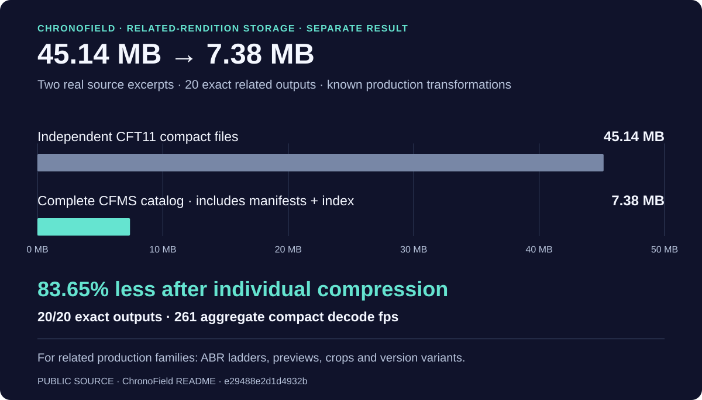

# ChronoField — original compression R&D

[Русский](README.ru.md) · [Public project and investor materials](https://github.com/Absamad-dew/chronofield-investor-materials/tree/e29488e2d1d4932bc94957d0d0c8ac60fff4b4e5)

I founded **ChronoField** to make exact video cheaper to store and move. My work combines a native exact-video codec with a related-rendition storage system. The retained three-source Full-HD result improves size **and** processing speed together: **41.37% fewer bytes, 8.42× encode speed and 4.98× decode speed** against strict-lossless AV1, with **exact RGB reconstruction verified by SHA-256**.

This operating point matters for media archives, exact-source and mezzanine storage, AI/computer-vision datasets and scientific workflows: less data to keep and transfer, with faster processing while retaining the original pixels. The broader public record reports **225 size wins in 225 recorded AV1 comparisons across 33 benchmark suites**. [Published result →](https://github.com/Absamad-dew/chronofield-investor-materials/blob/e29488e2d1d4932bc94957d0d0c8ac60fff4b4e5/README.md#current-proof)

## A second result: storage across related renditions

After each output has already been compressed, related production variants offer a separate storage opportunity. In the published family-storage benchmark, **45.14 MB of independent CFT11 compact files became a 7.38 MB complete CFMS catalog**, including manifests and index: **83.65% additional reduction**, with **20/20 exact outputs**.

The application is server-side rendition families produced through known transformations: ABR ladders, previews, crops and version variants. This is a distinct result and population from the three-source Full-HD comparison above. [Published family-storage result →](https://github.com/Absamad-dew/chronofield-investor-materials/blob/e29488e2d1d4932bc94957d0d0c8ac60fff4b4e5/COMPETITIVE_POSITION.md#the-result-that-matters)

## My contribution

**Absamad Manturov — ChronoField founder.** My R&D connects the native codec and decoder, exact related-rendition storage, retained benchmark comparisons and regression-gated releases. The public record describes a working CFT11 system, its native decoder, a 529-test release gate and a separate 598/598 combined project regression. The deliverable is an implemented compression and storage system with measurable operating points. [Public engineering record →](https://github.com/Absamad-dew/chronofield-investor-materials/blob/e29488e2d1d4932bc94957d0d0c8ac60fff4b4e5/README.md#current-proof)

> **Measurement context.** Author-retained local measurements on the same host and source frames: Ryzen 7 H 255, 8 cores / 16 threads, integrated Radeon 780M, 16 GB RAM. The Full-HD baseline is strict-lossless AV1 `cpu-used=4`; its three metrics share one retained aggregate. The storage result uses two source excerpts and 20 related renditions, with complete catalog size. Independent reproduction is the next public milestone. The linked note supplies scope and competitive context; implementation and unpublished mechanisms remain private. [Pinned methodology and scope →](https://github.com/Absamad-dew/chronofield-investor-materials/blob/e29488e2d1d4932bc94957d0d0c8ac60fff4b4e5/COMPETITIVE_POSITION.md)

[Measurement tooling: Compression Observatory](https://github.com/Absamad-dew/compression-observatory) · [Back to portfolio](../README.md)

[Other compression research](other-work.md)

[Independent validation brief](VALIDATION_BRIEF.md)
