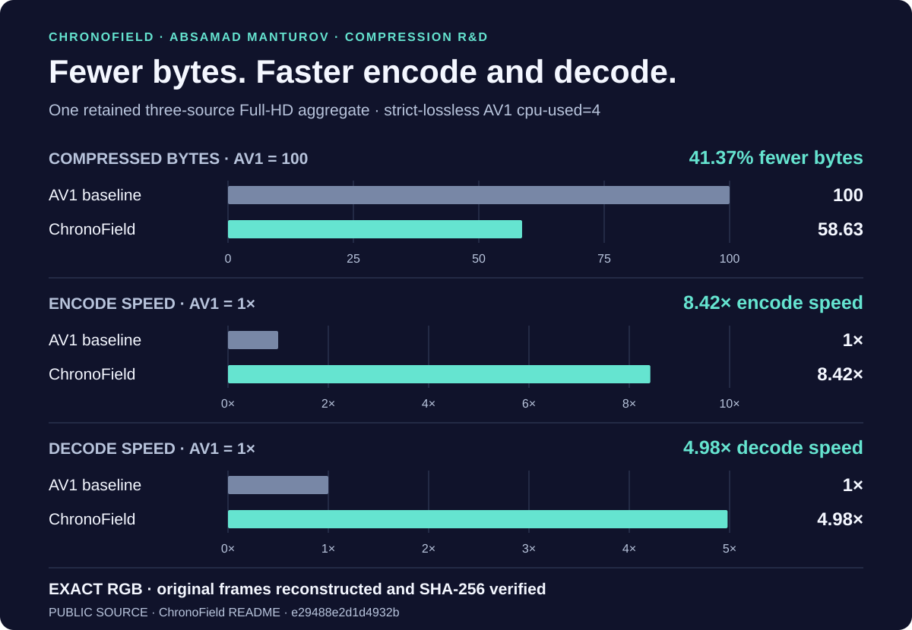
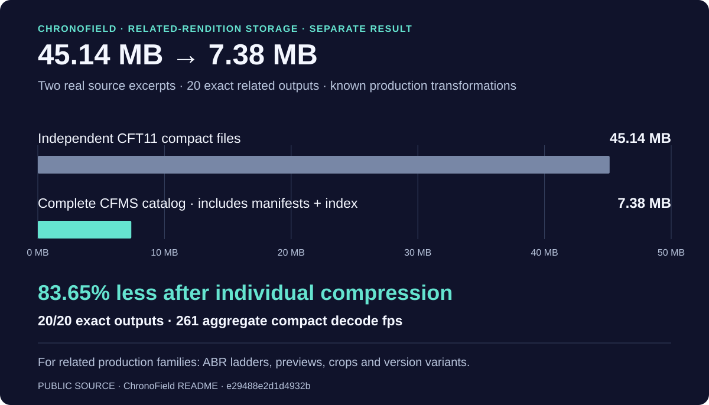

# ChronoField — авторские исследования сжатия

[English](README.md) · [Публичный проект и материалы](https://github.com/Absamad-dew/chronofield-investor-materials/tree/e29488e2d1d4932bc94957d0d0c8ac60fff4b4e5)

Я основал **ChronoField**, чтобы точное видео требовало меньше места и быстрее обрабатывалось. Моя работа объединяет нативный кодек точного видео и систему хранения связанных вариантов. В сохранённом сравнении на трёх Full-HD источниках получен одновременный выигрыш по размеру и скорости: **на 41,37% меньше байтов, скорость кодирования 8,42× и декодирования 4,98×** относительно AV1 в строгом lossless-режиме. **Исходные RGB-кадры восстанавливаются точно, с проверкой SHA-256.**

Такой результат полезен для медиаархивов, хранения исходников и промежуточного видео, датасетов ИИ и компьютерного зрения, научных рабочих процессов: меньше данных для хранения и передачи при более быстрой обработке и сохранении исходных пикселей. Более широкий публичный архив фиксирует **225 выигрышей по размеру в 225 записанных сравнениях с AV1, в 33 benchmark-наборах**. [Опубликованный результат →](https://github.com/Absamad-dew/chronofield-investor-materials/blob/e29488e2d1d4932bc94957d0d0c8ac60fff4b4e5/README.md#current-proof)

## Отдельный результат: хранение семейства вариантов

После индивидуального сжатия каждого выхода остаётся отдельная задача хранения связанных производственных вариантов. В опубликованном сравнении **45,14 МБ независимых компактных файлов CFT11 превратились в полный каталог CFMS объёмом 7,38 МБ**, включая манифесты и индекс: **ещё 83,65% сокращения**, с **точным восстановлением 20 из 20 выходов**.

Применение — серверные семейства, созданные известными производственными преобразованиями: ABR-лестницы, превью, кадрирование и версии. Этот результат относится к отдельному семейству данных, а не к трём Full-HD источникам на первом графике. [Публичное описание семейного хранения →](https://github.com/Absamad-dew/chronofield-investor-materials/blob/e29488e2d1d4932bc94957d0d0c8ac60fff4b4e5/COMPETITIVE_POSITION.md#the-result-that-matters)

## Мой вклад

**Абсамад Мантуров — основатель ChronoField.** Моя R&D-работа связывает нативный кодек и декодер, точное хранение связанных вариантов, сохранённые benchmark-сравнения и релизные проверки. Публично описаны работающая система CFT11, нативный декодер, релизный gate из 529 тестов и отдельная общая регрессия 598/598. Результат работы — реализованная система сжатия и хранения с измеренными рабочими точками. [Публичные инженерные результаты →](https://github.com/Absamad-dew/chronofield-investor-materials/blob/e29488e2d1d4932bc94957d0d0c8ac60fff4b4e5/README.md#current-proof)

> **Контекст измерений.** Авторские сохранённые локальные результаты: одинаковые машина и исходные кадры, Ryzen 7 H 255, 8 ядер / 16 потоков, встроенная Radeon 780M, 16 ГБ RAM. База Full-HD — строгий lossless AV1 `cpu-used=4`; три метрики относятся к одному сохранённому агрегату. Хранение измерено отдельно на двух фрагментах и 20 связанных вариантах, с учётом полного каталога. Следующий публичный этап — независимое воспроизведение. В связанном описании приведены границы и конкурентный контекст; реализация и неопубликованные механизмы остаются закрытыми. [Закреплённый источник и границы →](https://github.com/Absamad-dew/chronofield-investor-materials/blob/e29488e2d1d4932bc94957d0d0c8ac60fff4b4e5/COMPETITIVE_POSITION.md)

[Инструмент измерений: Compression Observatory](https://github.com/Absamad-dew/compression-observatory) · [К портфолио](../README.md)

[Другие направления исследований](other-work.md)

[План независимой проверки](VALIDATION_BRIEF.md)
